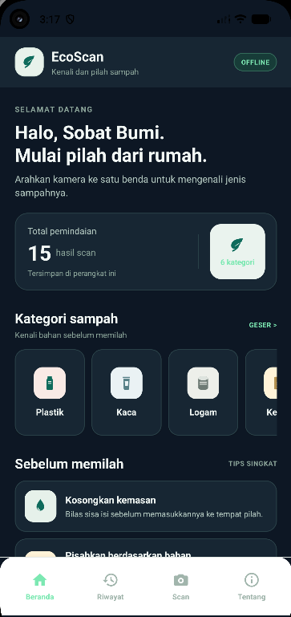
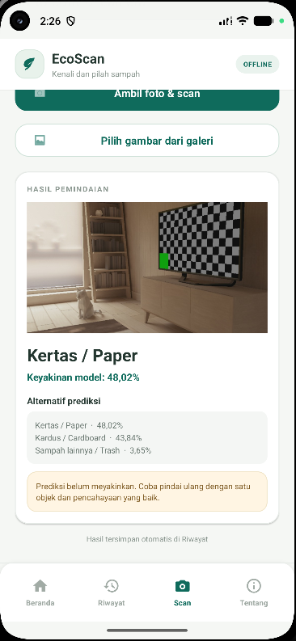

# EcoScan — Klasifikasi Gambar Sampah Android

EcoScan adalah aplikasi Android native untuk membantu mengenali kategori sampah dari foto. Aplikasi menggunakan model EfficientNetB0 yang dikemas dalam format TensorFlow Lite dan melakukan inferensi langsung pada perangkat.

> **Catatan:** nama repository dan package Android masih menggunakan identitas proyek TrashLens (`Trio-Project3-ML-TrashImageClassifier`, `com.trio.trashlens`), sedangkan antarmuka aplikasi menampilkan nama EcoScan.

## Fitur

- **Beranda:** ringkasan pemindaian, enam kategori sampah, dan tips singkat pemilahan.
- **Scan dengan kamera:** pratinjau kamera, pengambilan foto, dan klasifikasi satu objek.
- **Scan dari galeri:** pilih foto dari perangkat tanpa harus mengambil gambar baru.
- **Indikator loading:** spinner dan pesan status saat gambar sedang diproses.
- **Hasil klasifikasi:** label utama, skor confidence, dan skor alternatif yang tersedia.
- **Riwayat:** melihat hasil pemindaian yang tersimpan secara lokal.
- **Tentang:** informasi aplikasi, model, dan batasan hasil prediksi.
- **Pemrosesan offline:** model berjalan di perangkat; foto tidak dikirim ke server oleh alur klasifikasi aplikasi.

## Screenshot aplikasi

### Beranda



### Contoh hasil pemindaian dengan peringatan confidence rendah



Screenshot hasil di atas sengaja menunjukkan contoh ketika model belum yakin. Gunakan foto benda sampah yang nyata, tunggal, jelas, dan terang saat demo klasifikasi. Prediksi maupun confidence bukan jaminan bahwa objek telah dikenali dengan benar.

## Kategori yang didukung

Model menghasilkan prediksi untuk enam label berikut:

| Label model | Arti |
|---|---|
| `cardboard` | Kardus |
| `glass` | Kaca |
| `metal` | Logam |
| `paper` | Kertas |
| `plastic` | Plastik |
| `trash` | Sampah lainnya / tidak dapat didaur ulang dalam kelas yang tersedia |

Model hanya memiliki enam kelas tersebut. Aplikasi tidak menjamin dapat mengenali semua jenis sampah, objek campuran, atau benda yang tidak termasuk kelas training.

## Model Machine Learning

| Properti | Keterangan |
|---|---|
| Arsitektur | EfficientNetB0 |
| Model runtime Android | TensorFlow Lite (`.tflite`) |
| File model | `android/app/src/main/assets/trashnet_model_final.tflite` |
| Ukuran input | `224 × 224` piksel |
| Format input | RGB, `float32`, rentang nilai piksel `0–255`; model hasil ekspor mencakup rescaling internal |
| Output | Skor untuk enam kelas di atas |
| Validation accuracy tertinggi yang dilaporkan | `90,19%` |
| Test accuracy yang dilaporkan | `86,98%` (`334/384` gambar uji) |
| SHA-256 file model yang dicatat | `CF419FD9F21265ABCB6B985499BAE05865E538288802A25814B47600F62A4C62` |

### Dataset dan metode

Kode classifier proyek menyebut model ini sebagai model EfficientNetB0 untuk TrashNet, dan label output-nya terdiri dari enam kelas yang tercantum di atas. Namun, repository Android ini **tidak menyertakan dataset training, notebook/pipeline pelatihan, pembagian train/validation/test, atau konfigurasi hyperparameter**. Karena itu, versi atau mirror dataset yang tepat, jumlah gambar training, augmentasi, optimizer, jumlah epoch, serta detail transfer learning/fine-tuning tidak dapat diverifikasi hanya dari repository ini. Jangan menganggap detail tersebut sebagai fakta tanpa mencocokkannya dengan notebook atau laporan training asli.

Metrik di atas adalah hasil yang tercatat di dokumentasi proyek; artefak training/test yang dibutuhkan untuk mereproduksinya tidak ada di repository Android. Accuracy bukan jaminan prediksi pada foto baru. Periksa hasil secara visual sebelum menggunakan informasi tersebut untuk memilah sampah.

## Kebutuhan

- Android Studio yang mendukung Android Gradle Plugin dan Gradle Wrapper proyek.
- Android SDK Platform `36.1` / API 36 sesuai konfigurasi modul aplikasi.
- Perangkat Android atau emulator dengan minimum API 24 (Android 7.0).
- JDK yang kompatibel dengan Gradle Wrapper proyek. Gunakan Gradle JDK yang disarankan Android Studio; tidak perlu memasang Gradle terpisah karena repository menyediakan wrapper.
- Koneksi internet diperlukan saat pertama kali Gradle mengunduh plugin dan dependency. Setelah model dan aplikasi tersedia di perangkat, klasifikasi gambar tidak memerlukan pengiriman foto ke server.

## Build dan menjalankan aplikasi

### Opsi A — Android Studio

1. Clone repository atau ekstrak arsip proyek.
2. Buka Android Studio, lalu pilih **Open** dan pilih folder `android/` (bukan hanya folder `app/`).
3. Tunggu **Gradle Sync** selesai. Selesaikan unduhan dependency jika diminta.
4. Pilih perangkat Android yang terhubung atau jalankan emulator API 24 ke atas.
5. Pilih konfigurasi `app`, lalu tekan **Run**.
6. Saat pertama kali memakai fitur kamera, izinkan akses kamera.

### Opsi B — PowerShell di Windows

Dari direktori root repository, jalankan:

```powershell
cd android
.\gradlew.bat :app:assembleDebug
```

Build berhasil jika terminal menampilkan `BUILD SUCCESSFUL`. Untuk memasang aplikasi ke perangkat/emulator yang sedang aktif:

```powershell
.\gradlew.bat :app:installDebug
```

APK debug berada di:

```text
android/app/build/outputs/apk/debug/app-debug.apk
```

### Alur penggunaan

1. Buka aplikasi dan lihat beranda.
2. Buka tab **Scan**.
3. Untuk kamera, izinkan permission jika diminta, arahkan kamera ke satu benda sampah, lalu tekan tombol ambil foto/scan.
4. Tunggu spinner berhenti, lalu baca kategori, confidence, dan alternatif prediksi.
5. Atau tekan tombol galeri dan pilih foto benda sampah yang jelas.
6. Buka **Riwayat** untuk melihat scan yang tersimpan, lalu buka **Tentang** untuk penjelasan aplikasi/model.

## Privasi dan pemrosesan offline

- Izin kamera digunakan untuk mengambil foto melalui aplikasi.
- Model TFLite dimuat dari folder `assets` dan melakukan inferensi secara lokal di perangkat.
- Foto dan informasi riwayat dikelola secara lokal oleh aplikasi. Konfigurasi manifest tidak meminta izin internet, dan alur klasifikasi tidak mengunggah foto ke server.
- Build pertama tetap dapat membutuhkan internet untuk mengunduh dependency Gradle.

## Struktur repository

```text
.
├── README.md
├── docs/
│   ├── DEMO.md
│   └── screenshots/
│       ├── home.png
│       └── scan-result.png
└── android/
    ├── app/
    │   └── src/main/
    │       ├── assets/trashnet_model_final.tflite
    │       ├── java/com/trio/trashlens/
    │       │   ├── MainActivity.kt
    │       │   └── TfliteImageClassifier.kt
    │       ├── res/layout/activity_main.xml
    │       └── AndroidManifest.xml
    ├── gradle/wrapper/
    └── gradlew.bat
```

## Troubleshooting

- **Gradle Sync/build gagal:** pastikan Android Studio menggunakan JDK yang kompatibel, koneksi internet tersedia untuk unduhan awal, lalu coba `.\gradlew.bat :app:assembleDebug` dari folder `android/`.
- **Kamera tidak aktif:** izinkan permission kamera. Jika sebelumnya ditolak permanen, buka Settings Android → Apps → EcoScan/TrashLens → Permissions → Camera.
- **Model gagal dimuat:** pastikan `trashnet_model_final.tflite` ada pada `android/app/src/main/assets/` dan tidak dipindahkan atau diganti namanya.
- **Prediksi salah atau confidence rendah:** gunakan satu objek yang memenuhi frame, pencahayaan yang baik, latar belakang sederhana, lalu coba foto ulang. Confidence adalah skor model, bukan jaminan kebenaran.

## Skenario demo

Lihat [docs/DEMO.md](docs/DEMO.md) untuk urutan demo singkat, persiapan benda uji, dan langkah cadangan jika permission kamera atau prediksi tidak sesuai harapan.
